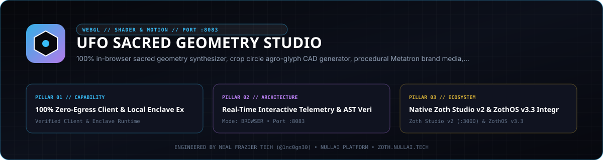

# UFO Sacred Geometry Studio

<p align="center">
  
</p>

Pure-Python parametric sacred geometry, agro-glyph (crop circle), Kepler-Poinsot star polyhedron, Fibonacci phyllotaxis, and cymatic resonance CAD engine with multi-format exporters (`SVG`, AutoCAD `DXF` R12/2000, Wavefront `OBJ`, `JSON`), local HTTP workstation, and 9-tool Model Context Protocol (MCP) server. Zero external Python runtime dependencies.

- **Version**: `2.5.0`
- **Default Loopback Endpoint**: `http://127.0.0.1:8083`
- **Zoth Studio v2 Dossier**: [https://zoth.nullai.tech/tools/ufo-sacred-geometry](https://zoth.nullai.tech/tools/ufo-sacred-geometry)
- **Author**: 1nc0gn30 (`@1nc0gn30` · [https://1nc0gn30.si](https://1nc0gn30.si)) & NullAI ([https://nullai.tech](https://nullai.tech))
- **License**: MIT (100% free and open-source)

## Overview

UFO Sacred Geometry Studio (`ufo-sacred-geometry`) constructs exact mathematical geometry ASTs (`Circle`, `Arc`, `LineSegment`, `Polygon`, `Spline`) in `src/ufo_sacred_geometry/` and renders them across CAD/3D formats and an interactive HTML5 Canvas workstation (`public/index.html`):

- **Sacred & Platonic Generators (`generators/`)**: Flower of Life, Seed/Egg/Fruit of Life, Vesica Piscis, Metatron's Cube (13-center Platonic projection), Sri Yantra, Merkaba, Tree of Life, Golden Ratio spirals/rectangles/triangles, and Golden Ratio tori.
- **Historical Agro-Glyphs & Phyllotaxis**: Milk Hill 409-circle Julia set, Barbury Castle tetrahedron, Chilbolton binary glyph, triskele vortices, and Golden-Angle (`137.507764°`) Fibonacci phyllotaxis parastichy discs.
- **Star Polyhedra & Cymatic Resonance (`star_polyhedra.py`)**: Kepler-Poinsot and Archimedean projections (`cuboctahedron`, `small_stellated_dodecahedron`, `great_stellated_dodecahedron`, `icosidodecahedron`, `truncated_icosahedron`) plus Chladni cymatic nodal plates across Solfeggio (`174–963 Hz`) and Schumann (`7.83 Hz`) frequencies.
- **CAD & 3D Exporters (`exporters/`)**: Scalable `SVG` (`gold`, `blueprint`, `neon_matrix`, `obsidian_dark`, `light_minimal` themes), AutoCAD `DXF` (CNC/laser/waterjet ready), and 3D extruded/beveled Wavefront `OBJ` relief meshes.

## Architecture

```text
ufo-sacred-geometry/
├── assets/hero-banner.svg                  # Studio vector banner
├── bin/ufo-geometry.js                     # Unified CLI, web, and Electron launcher
├── public/index.html                       # Interactive HTML5 Canvas CAD workstation
├── src/ufo_sacred_geometry/
│   ├── models.py                           # GeometryAST, Point2D/3D, Circle, Arc, Polygon, Spline
│   ├── catalog.py                          # Preset catalog, category filters, & harmonic metadata
│   ├── generators/                         # Sacred geometry, agro-glyph, star polyhedra, & cymatics
│   ├── exporters/                          # SVG, AutoCAD DXF R12/2000, & Wavefront OBJ exporters
│   ├── ui_server.py                        # ThreadingHTTPServer REST API & static host (:8083)
│   ├── mcp_server.py                       # JSON-RPC 2.0 stdio MCP server (2024-11-05, 9 tools)
│   └── cli.py                              # Subcommand CLI (ufo-sacred-geometry / ufogeom)
└── tests/                                  # Pytest AST, generator, exporter, CLI, MCP, & HTTP suite
```

## Quickstart

Clone the repository and install in editable mode:

```bash
git clone https://github.com/1nc0gn30/ufo-sacred-geometry.git
cd ufo-sacred-geometry
python3 -m pip install -e ".[dev]"
```

Launch the local web workstation and REST server on `127.0.0.1:8083`:

```bash
ufogeom serve --host 127.0.0.1 --port 8083
# or via the Node wrapper:
node bin/ufo-geometry.js web
```

Verify service health:

```bash
curl -s http://127.0.0.1:8083/health
```

## CLI & MCP Usage

### CLI Subcommands

Entry points `ufo-sacred-geometry`, `sacred-geometry`, `ufogeom`, and `node bin/ufo-geometry.js` share the same subcommands:

```bash
# Help, version, and JSON status
ufogeom --help
ufogeom --version
ufogeom --status --json

# List presets filtered by category (all, sacred, crop_circle, spiral, yantra, field, platonic)
ufogeom presets --category all --json

# Generate a pattern AST or vector/CAD file with custom parameters
ufogeom generate metatrons_cube --radius 120 --iterations 2 --theme blueprint -f svg -o metatron.svg
ufogeom generate crop_circle --glyph-type julia_set --radius 140 -f dxf -o milk_hill.dxf
ufogeom generate phyllotaxis --seed-count 400 --divergence-angle 137.507764 --json

# Direct CAD/3D export to SVG, DXF, or extruded Wavefront OBJ
ufogeom export flower_of_life -f dxf --radius 100 --iterations 3 -o flower.dxf
ufogeom export merkaba -f obj --radius 120 --extrusion 5.0 --bevel --base-plate -o merkaba.obj

# System diagnostics and internal self-verification
ufogeom doctor --json
ufogeom test
```

### ZothOS v3.4.0 Integration

On ZothOS v3.4.0 workstations, `ufo-geometry` and `ufogeom` are linked onto the system `PATH` and pair with the Zoth Studio v2 dossier (`https://zoth.nullai.tech/tools/ufo-sacred-geometry`) over loopback port `127.0.0.1:8083`.

### REST API Endpoints (`127.0.0.1:8083`)

| Method | Path | Description |
| :--- | :--- | :--- |
| `GET` | `/health`, `/api/health` | Service health and uptime in seconds |
| `GET` | `/api/presets`, `/presets` | Full catalog of sacred geometry and agro-glyph presets |
| `GET` | `/api/stats`, `/stats` | Version, generation count, preset count, and supported exporters |
| `GET` | `/api/diagnostics`, `/diagnostics` | Platform info, mathematical constants (`phi`, `sqrt(3)`, Golden Angle), and endpoint list |
| `GET`, `POST` | `/api/generate` | Generate pattern AST, execution latency, stats, and `svg_preview` |
| `GET`, `POST` | `/api/export-svg` | Download compiled vector `.svg` attachment |
| `GET`, `POST` | `/api/export-dxf` | Download AutoCAD `.dxf` attachment |
| `GET`, `POST` | `/api/export-obj` | Download 3D extruded Wavefront `.obj` mesh attachment |

### MCP Server (`stdio`)

Start the JSON-RPC 2.0 MCP server (`protocolVersion: 2024-11-05`):

```bash
ufogeom mcp
```

Registered MCP tools (9), resources (`geometry://presets`, `geometry://catalog`), and prompts (`geometry_create_crop_circle`, `geometry_create_mandala`):

1. `geometry_generate` — Generate pattern AST and themed SVG markup.
2. `geometry_export_svg` — Export scalable vector SVG with theme and glow controls.
3. `geometry_export_dxf` — Export AutoCAD R12/2000 DXF geometry for CNC/laser tooling.
4. `geometry_export_obj` — Export 3D extruded/beveled Wavefront OBJ relief meshes.
5. `geometry_presets` — Query presets by category (`all`, `sacred`, `crop_circle`, `spiral`, `yantra`, `field`).
6. `geometry_phyllotaxis` — Generate Golden-Angle Fibonacci phyllotaxis seed spirals.
7. `geometry_diagnostics` — Run floating-point precision and exporter diagnostics.
8. `geometry_star_polyhedron` — Project 3D Kepler-Poinsot and Archimedean star polyhedra.
9. `geometry_sacred_resonance` — Synthesize Chladni cymatic nodal geometry for Solfeggio and Schumann frequencies.

## Testing & Verification

Run the test suite and secret scan locally:

```bash
python3 -m pytest -q
node bin/ufo-geometry.js --status --json
gitleaks detect --source . --no-banner --redact
```

## Support

UFO Sacred Geometry Studio is 100% free and open-source with zero paywalls. Optional community support: [Buy Us a Coffee via Stripe](https://buy.stripe.com/3cIfZg27PdKo2D64Ocfw40X).

## License

Released under the [MIT License](LICENSE). Copyright (c) 2026 1nc0gn30 & NullAI ([https://nullai.tech](https://nullai.tech)).
